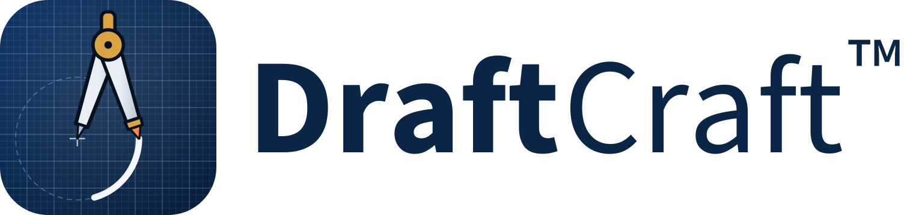
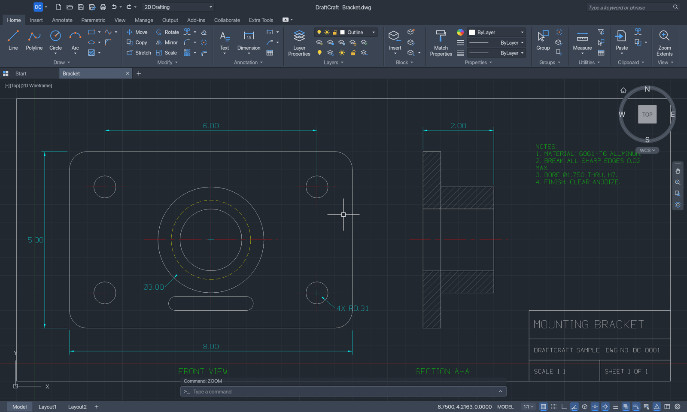
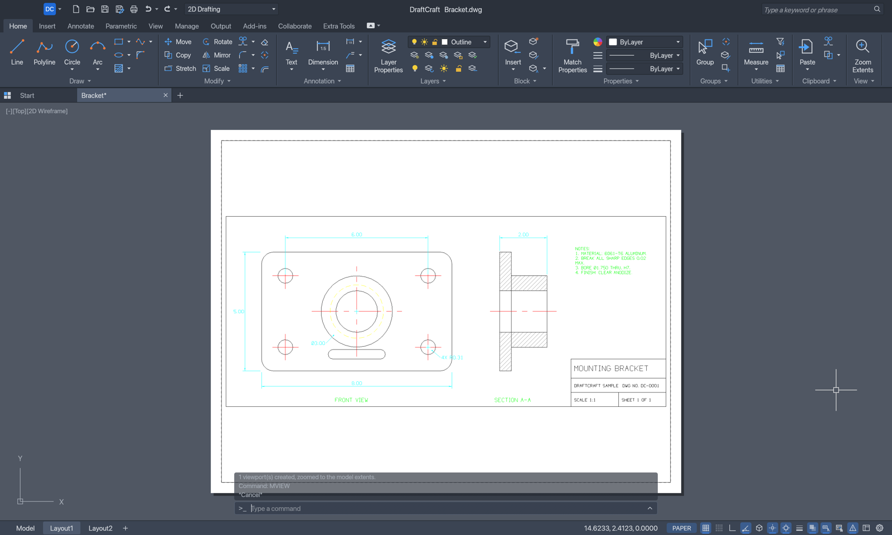
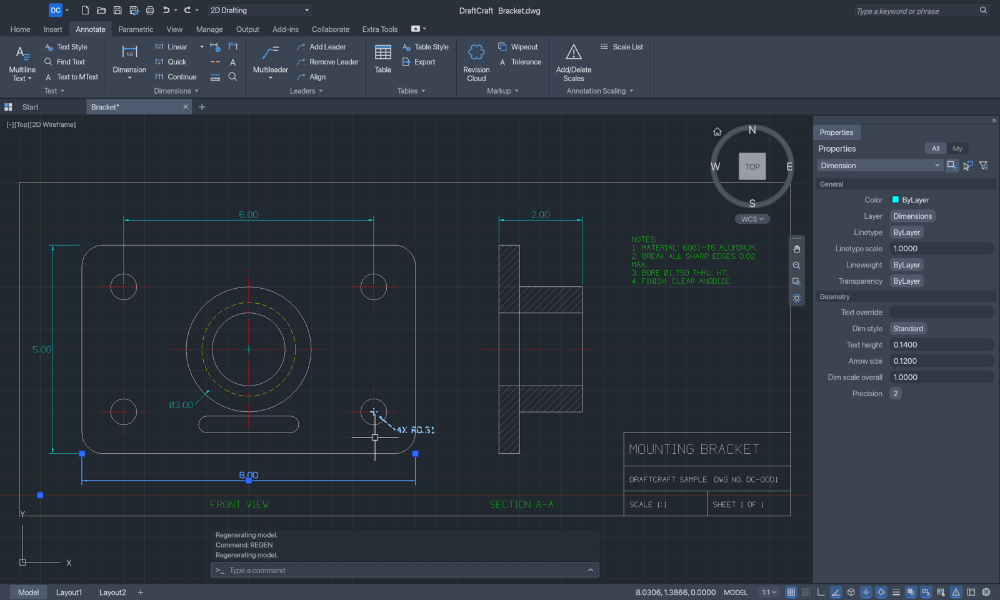
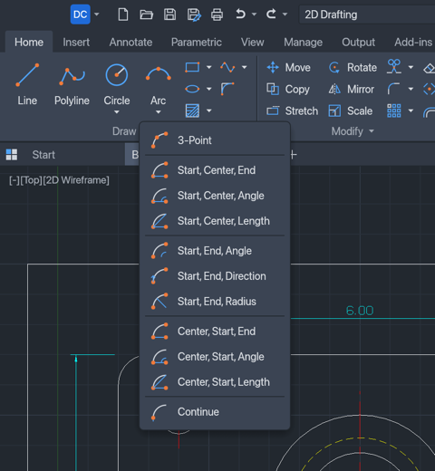
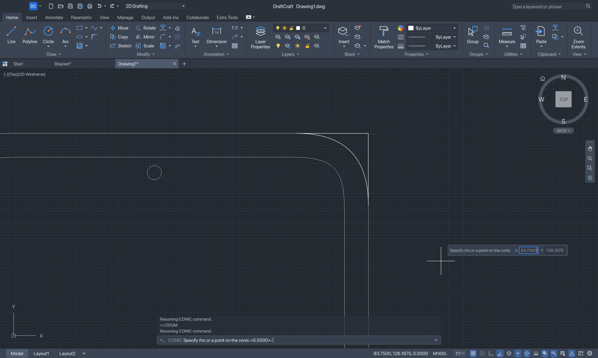

<p align="center">
  <picture>
    <source media="(prefers-color-scheme: dark)" srcset="docs/brand/draftcraft-logo-dark.svg">
    
  </picture>
</p>

<p align="center">
  <b>Open-source 2D drafting with the ribbon you know, built in pure Rust.</b>
</p>

<p align="center">
  DWG and DXF drawings with the command line, object snaps, layers, dimensions, hatches, blocks and layouts
  you already know, under a Windows-style ribbon. It runs natively on macOS, Windows and Linux, and agents
  can drive it through MCP.
</p>

<p align="center">
  <a href="https://github.com/SkryxDev/DraftCraft/releases/latest/download/draftcraft-windows-x64.zip"></a>
  <a href="https://github.com/SkryxDev/DraftCraft/releases/latest/download/draftcraft-macos-arm64.dmg"></a>
  <a href="https://github.com/SkryxDev/DraftCraft/releases/latest/download/draftcraft-linux-x86_64.AppImage"></a>
</p>

<p align="center">
  <a href="https://ko-fi.com/K0O529L823"></a>
  <a href="https://discord.gg/YgRK8Eww9x"></a>
</p>

<p align="center">
  
  
  
  
  
</p>

<p align="center">
  <a href="#screenshots">Screenshots</a> ·
  <a href="#downloads">Downloads</a> ·
  <a href="#why-draftcraft">Why DraftCraft™</a> ·
  <a href="#conic-arcs">Conic arcs</a> ·
  <a href="#what-works-today">What works today</a> ·
  <a href="#quick-start">Quick start</a> ·
  <a href="#drive-it-from-agents-mcp-and-the-cli">Agents</a> ·
  <a href="#made-by">Made by</a> ·
  <a href="#license">License</a>
</p>

> [!NOTE]
> **DraftCraft™ is a fork.** It's [CADCraft](https://github.com/storytold/cadcraft), the ArtCraft team's
> open-source CAD application, grown toward native, lossless DWG by [WithShalom Studios](https://github.com/withshalom)
> (originally as DWGCraft) and given the Windows-style ribbon you know from AutoCAD by
> [SkryxDev](https://github.com/SkryxDev) (originally as RustDraft).
> It is not made, endorsed or supported by the ArtCraft team, and it is not affiliated with Autodesk, Inc.
> AutoCAD and DWG are Autodesk's trademarks, used only to say which files and workflows DraftCraft works with.

<p align="center">
  
  <br><sub><b>Mounting bracket</b>, the sample drawing (Help › Open Sample Drawing): the Home tab of the ribbon, the command line floating over the drawing and the drafting toggles on the status bar.</sub>
</p>

## Screenshots

<table>
  <tr>
    <td width="50%"></td>
    <td width="50%"></td>
  </tr>
  <tr>
    <td><sub><b>Layouts</b>: paper space with viewports, page setups and PLOT to PDF.</sub></td>
    <td><sub><b>Properties</b>: selection grips and a palette that edits any object.</sub></td>
  </tr>
  <tr>
    <td colspan="2" align="center"></td>
  </tr>
  <tr>
    <td colspan="2" align="center"><sub><b>Split buttons</b>: Arc ▾, Circle ▾, Trim ▾ … list every method, each with its own picture.</sub></td>
  </tr>
</table>

## Why DraftCraft™

- **The workflow you know.** Type `L`, click two points, type `@5<45`, press Enter. The command line,
  prompts with clickable `[Keywords]`, AutoComplete, object snaps, polar tracking, ortho, direct distance
  entry, window and crossing selection, grips and right-click-to-repeat behave the way drafting habit
  expects.
- **The ribbon you know.** Home, Insert, Annotate, Parametric, View, Manage, Output, Add-ins, Collaborate
  and Extra Tools, with large, small and split buttons, the layer list and the property lists, the
  application menu and the Quick Access Toolbar — the same on macOS, Windows and Linux. On Windows the menu
  bar sits in the title bar.
- **Open files.** DWG and DXF are read and written at the version you choose (2000 to 2018), and the DWG
  files open in AutoCAD. Plot to PDF, export SVG and PNG.
- **Things other CAD tools don't do.** CONIC draws exact conic arcs, saved as rational splines every DWG
  and DXF program reads.
- **Fast and native.** Pure Rust and egui, no Electron, no web view, drawing on the GPU.
- **Built for agents.** Every menu item, tool and prompt is a command. Agents type at the command line like
  a person, call any command with JSON, inspect the drawing and render it — over MCP, a JSON control
  channel or the CLI.
- **Free.** MIT OR Apache-2.0, with no account and no subscription.

## Conic arcs

<p align="center">
  
  <br><sub><b>CONIC</b> drawing the corner of a phone in plan view: the end tangents meet at the apex, and the preview follows the cursor until you give rho.</sub>
</p>

Most CAD programs draw corners with circular fillets, which can't make the soft, continuous corners of a
phone, a car body or a bottle. **CONIC** draws an exact **conic arc** — a piece of an ellipse, a parabola or
a hyperbola — from four inputs:

1. the **start point**,
2. the **apex**: where the tangents at the two ends meet,
3. the **end point**,
4. **rho**, the shape: type a value, or click a point the curve should pass through.

| rho | Curve | Looks like |
|---|---|---|
| below 0.5 | ellipse | a soft, open corner |
| 0.5 | parabola | the default |
| above 0.5 | hyperbola | a full, square-ish corner that hugs the apex |

```text
conic 0,0 5,5 10,0 0.6          start, apex, end, rho
```

Find it on the ribbon in **Home › Draw**, next to **Spline**. The curve is saved as an exact **rational
spline** (NURBS), an entity every DXF and DWG program already has: AutoCAD opens it as an ordinary spline you
can edit with grips, in DXF and in DWG at every version. Agents and scripts call it with
`{"command": "conic", "params": {"start": [0,0], "apex": [5,5], "end": [10,0], "rho": 0.6}}`, or `through`
in place of `rho`.

## What works today

DraftCraft is young and moving fast. [ROADMAP.md](ROADMAP.md) has what is missing and what comes next.

| Area | Status |
|---|---|
| Interface | Windows-style ribbon (10 tabs, split buttons, layer and property lists), application menu, Quick Access Toolbar, file tabs, floating command line, ViewCube and navigation bar, status bar toggles, Properties and Layers palettes, 18 languages |
| Command line | AutoCAD command names and aliases, prompts with keywords, AutoComplete, `@dx,dy`, `@d<a`, `#x,y`, direct distance entry, transparent commands, scripts |
| Draw | LINE, PLINE (arcs, widths), CIRCLE, ARC, RECTANG, POLYGON, ELLIPSE, SPLINE, CONIC, POINT, XLINE, RAY, DONUT, REVCLOUD, WIPEOUT, TEXT, MTEXT |
| Modify | ERASE, MOVE, COPY, ROTATE, SCALE, MIRROR, STRETCH, OFFSET, TRIM, EXTEND, FILLET, CHAMFER, BREAK, JOIN, EXPLODE, arrays, draw order, OVERKILL, grips |
| Precision | Object snaps, polar tracking, ortho, grid snap, dynamic input |
| Annotation | DIM commands with dimension styles and associative dimensions, multileaders, tables, TrueType and SHX fonts, right-to-left text |
| Hatches and blocks | Pattern, solid and gradient fills; blocks, attributes, the Block Editor, in-place editing, external references |
| Parametric | Geometric and dimensional constraints, AUTOCONSTRAIN, parameters with expressions |
| Layouts and output | Paper-space layouts, viewports, page setups, plot styles, PLOT and EXPORTPDF (arcs, circles and splines kept as true curves), SVG and PNG export |
| Files | DWG and DXF reading and writing at a chosen version, AUDIT and RECOVER, autosave and drawing recovery. Objects DraftCraft doesn't model yet can be lost on save |
| Automation | MCP server, JSON control channel, `draftcraft-cli`, AutoLISP, scripts and alias files |

## Quick start

Typing works like in AutoCAD: start typing anywhere in the drawing and it goes to the command line.

```text
line 0,0 @10,0 @0,5 c          a closed triangle
circle 5,2 1                    a circle
conic 0,0 5,5 10,0 0.6          a conic arc: start, apex, end, rho
offset 0.25                     then pick the circle and a side
zoom e                          zoom to the drawing's extents
```

On Windows and Linux, <kbd>Ctrl</kbd> takes the place of <kbd>⌘</kbd>.

| Keys | Action |
| --- | --- |
| <kbd>⌘</kbd><kbd>N</kbd> <kbd>⌘</kbd><kbd>O</kbd> <kbd>⌘</kbd><kbd>S</kbd> | New, open, save |
| <kbd>⇧</kbd><kbd>⌘</kbd><kbd>S</kbd> | Save as |
| <kbd>⌘</kbd><kbd>P</kbd> | Plot |
| <kbd>⌘</kbd><kbd>Z</kbd> <kbd>⇧</kbd><kbd>⌘</kbd><kbd>Z</kbd> | Undo, redo |
| <kbd>⌘</kbd><kbd>X</kbd> <kbd>⌘</kbd><kbd>C</kbd> <kbd>⌘</kbd><kbd>V</kbd> | Cut, copy, paste |
| <kbd>⇧</kbd><kbd>⌘</kbd><kbd>C</kbd> <kbd>⇧</kbd><kbd>⌘</kbd><kbd>V</kbd> | Copy with base point, paste as block |
| <kbd>⌘</kbd><kbd>A</kbd> | Select all |
| <kbd>⌘</kbd><kbd>F</kbd> | Find and replace |
| <kbd>⌘</kbd><kbd>1</kbd> | Properties palette |
| <kbd>⌘</kbd><kbd>9</kbd> | Show or hide the command line |
| <kbd>F1</kbd> | Command reference |
| <kbd>F2</kbd> | Command history |
| <kbd>F3</kbd> | Object snap |
| <kbd>F7</kbd> <kbd>F8</kbd> <kbd>F9</kbd> | Grid, ortho, snap |
| <kbd>F10</kbd> <kbd>F11</kbd> <kbd>F12</kbd> | Polar tracking, object snap tracking, dynamic input |
| <kbd>Delete</kbd> | Erase the selection |
| <kbd>esc</kbd> | Cancel the command |
| <kbd>↩</kbd> or <kbd>space</kbd> | Repeat the last command |

### Build from source

Requirements: **Rust 1.95** or later. On Linux, also the development packages for X11/Wayland and
fontconfig (`pkg-config libxkbcommon-dev libwayland-dev libx11-dev libfontconfig1-dev` on Debian/Ubuntu).

```bash
git clone https://github.com/SkryxDev/DraftCraft.git
cd DraftCraft
cargo run --release -p draftcraft -- --sample
```

`--sample` opens the sample drawing. `cargo build --release -p draftcraft -p draftcraft-cli` builds the app
and the CLI into `target/release/`. The interface fonts for Chinese, Japanese, Korean, Arabic, Thai and more
come from the optional [craft-fonts](https://github.com/storytold/craft-fonts) repository: clone it and set
`CRAFT_FONTS_DIR=/path/to/craft-fonts` before building to embed them. Without it DraftCraft uses the fonts
installed on your system.

The quality checks — formatting, clippy, tests, asset licences, crate layering and the web build — run with
`cargo xtask ci`. Releases are built by [the release workflow](.github/workflows/release.yml) when a `v*`
tag is pushed; see [docs/releasing.md](docs/releasing.md).

## Drive it from agents, MCP and the CLI

DraftCraft ships an [MCP](https://modelcontextprotocol.io) server. Add it to Claude Desktop, Claude Code or
any MCP client, and the agent draws in the open DraftCraft window while you watch (on macOS it opens the app
when needed):

```json
{
  "mcpServers": {
    "draftcraft": {
      "command": "/Applications/DraftCraft.app/Contents/MacOS/draftcraft-cli",
      "args": ["mcp", "--connect", "127.0.0.1:7982", "--launch"]
    }
  }
}
```

The agent types at the command line (`command_line`), runs any command with JSON parameters (`execute`),
reads the drawing (`inspect_drawing`, `query_entities`, `find_text`) and looks at it (`render`,
`screenshot`). `draftcraft-cli mcp` with no `--connect` works on its own, without a window.

The CLI also converts and renders drawings in scripts:

```bash
draftcraft-cli info drawing.dwg
draftcraft-cli convert drawing.dxf drawing.pdf
draftcraft-cli run --sample --script 'CIRCLE 22,3 1\n' --save out.dxf --export out.png
```

More: [MCP](docs/mcp.md) · [CLI](docs/cli.md) · [control channel](docs/control-protocol.md) ·
[LISP, scripts and aliases](docs/customization.md) · [AutoLISP](docs/autolisp.md)

## Downloads

One click downloads the newest version from the [latest release](https://github.com/SkryxDev/DraftCraft/releases/latest):

| System | Download |
|---|---|
| Windows 10 and 11 | [64-bit (x64)](https://github.com/SkryxDev/DraftCraft/releases/latest/download/draftcraft-windows-x64.zip) · [ARM64](https://github.com/SkryxDev/DraftCraft/releases/latest/download/draftcraft-windows-arm64.zip) |
| macOS 11 or later (Apple silicon) | [Disk image](https://github.com/SkryxDev/DraftCraft/releases/latest/download/draftcraft-macos-arm64.dmg) |
| Linux, any distribution | [AppImage x86_64](https://github.com/SkryxDev/DraftCraft/releases/latest/download/draftcraft-linux-x86_64.AppImage) |

The release page also has the macOS command-line tool on its own (`draftcraft-cli-macos-arm64.zip`) and
`SHA256SUMS.txt`. Every download includes `draftcraft-cli`, the command-line and MCP tool.

- **Windows** — unzip the folder anywhere and run `DraftCraft.exe`. The build isn't signed, so SmartScreen
  may stop it the first time: choose **More info**, then **Run anyway**. DraftCraft draws its own title bar
  there, with the menu bar in it; set `DRAFTCRAFT_TITLEBAR=system` to keep Windows' own.
- **macOS** — open the disk image and drag **DraftCraft** into **Applications**. It isn't notarized yet, so
  the first time open it once, then **System Settings › Privacy & Security › Open Anyway** — or run
  `xattr -dr com.apple.quarantine /Applications/DraftCraft.app`.
- **Linux** — make the AppImage executable (`chmod +x draftcraft-linux-x86_64.AppImage`) and run it.

DraftCraft tells you when a newer version is out: it asks GitHub when it starts, and **Help › Check for
Updates…** checks at any time. That one request to `api.github.com` is all it sends; set
`DRAFTCRAFT_NO_UPDATE_CHECK=1` to turn it off.

## Architecture

```
crates/
├── geom/          f64 geometry: arcs, bulges, splines, conics, intersections, offsets
├── dxf/           DXF tag reader and writer
├── dwg/           DWG reading and writing
├── color/         colour index and true colour
├── doc/           the drawing database (copy-on-write entities, cheap undo)
├── fonts/         our own stroke font, TrueType and TEXT/MTEXT layout
├── render/        display lists, linetypes, hatches, dimensions, CPU raster
├── constraints/   geometric and dimensional constraint solver
├── io/            DXF/DWG mapping, SVG, PNG and PDF export
├── engine/        sessions, commands, command line and prompts, snaps, selection, undo
├── ui-egui/       the interface: ribbon, canvas, palettes, dialogs
└── mcp/           the MCP server
apps/
├── draftcraft/     the desktop app
├── draftcraft-cli/ the command-line tool
└── draftcraft-web/ a browser build (WebAssembly)
```

- **Everything is a command.** The ribbon, menus, command line, scripts, the CLI, the control channel and
  MCP all run the same commands, defined once in `crates/engine/src/cmd/`.
- **The interface is a thin layer.** Nothing below `ui-egui` knows about the GUI toolkit, and
  `cargo xtask layers` checks it.
- **It never panics on your data.** Files, typed input and agent requests are treated as hostile; every
  command runs behind a guard that restores the drawing and reports an error instead of crashing.
- **Drawing happens on the GPU** through wgpu (Metal, DirectX 12, Vulkan), with a CPU fallback.
- **No borrowed artwork.** Every interface icon is drawn in code, and the hatch patterns, linetypes and
  drafting font are our own definitions; [ATTRIBUTION.md](ATTRIBUTION.md) lists every asset file.

Settings, logs and autosaves live in `~/Library/Application Support/DraftCraft` on macOS,
`%APPDATA%\DraftCraft` on Windows and `~/.config/draftcraft` on Linux.

## Found a bug?

Please [open an issue](https://github.com/SkryxDev/DraftCraft/issues/new) with what you did, what you
expected and what happened — a screenshot or the drawing helps a lot. The log file is in the `logs` folder
of the settings directory above. Or come and say it on [Discord](https://discord.gg/YgRK8Eww9x).

Pull requests are welcome too: fork the repository, make your change on a branch, run `cargo xtask ci`, and
[open a pull request](https://github.com/SkryxDev/DraftCraft/pulls).

## Made by

DraftCraft™ is made together by **[SkryxDev](https://github.com/SkryxDev)** and
**[WithShalom Studios](https://github.com/withshalom)**. SkryxDev built the program as RustDraft (versions 1.0 and
1.1): the Windows-style ribbon, CONIC's conic arcs and DWG files that AutoCAD opens. WithShalom Studios brought the
DraftCraft name and its work toward native, lossless DWG, which joins the main build as it lands. Both started from
[CADCraft](https://github.com/storytold/cadcraft) by the ArtCraft Team and the CADCraft contributors, credited in
[NOTICE](NOTICE).

## License

DraftCraft is dual-licensed under the [MIT License](LICENSE-MIT) or the [Apache License 2.0](LICENSE-APACHE),
at your option; the copyright notices are in [LICENSE-MIT](LICENSE-MIT) and [NOTICE](NOTICE). Bundled fonts
and other asset files keep their own open licences, listed in [ATTRIBUTION.md](ATTRIBUTION.md).

DraftCraft™, the DraftCraft logo and the DraftCraft app icon were created by WithShalom Studios, which first
claimed DraftCraft as its trademark; they are WithShalom Studios' trademarks, used in this project by agreement.
The licences above cover the code, not the name, the logo or the icon: you may fork and redistribute the code,
but a modified version must not be presented as DraftCraft. The full terms are in
[docs/brand/LICENSE-brand.txt](docs/brand/LICENSE-brand.txt).

<details>
<summary>DraftCraft brand terms</summary>

```text
DraftCraft brand terms

The marks
  - the name DraftCraft™ (also written DRAFTCRAFT or Draftcraft);
  - the DraftCraft logo: the wordmark with the compass icon (docs/brand/draftcraft-logo.svg and
    docs/brand/draftcraft-logo-dark.svg);
  - the DraftCraft app icon: a drafting compass and the arc it drew on a blueprint-blue tile with a
    drafting grid (assets/app-icon/, including assets/app-icon/src/draftcraft-icon.svg and
    assets/app-icon/src/draftcraft-icon-macos.svg).

Origin
  The DraftCraft name, the logo and the app icon were created by WithShalom Studios, which first used
  them and first claimed DraftCraft as its trademark, for its drafting application at
  https://github.com/withshalom/draftcraft (2026). DraftCraft™ and the DraftCraft logo are trademarks
  of WithShalom Studios. The ™ sign marks a claimed trademark; it is not a registration.

Use in this repository
  WithShalom Studios lets this repository (https://github.com/SkryxDev/DraftCraft, formerly
  https://github.com/SkryxDev/RustDraft, under whatever name it later carries) and its maintainer,
  SkryxDev, use the marks for the application developed here, which SkryxDev and WithShalom Studios
  develop together. SkryxDev made the program, released as RustDraft (versions 1.0 and 1.1); from
  version 2.0 it carries the DraftCraft name, logo and app icon by this agreement. SkryxDev keeps the
  credit for RustDraft and for his work in DraftCraft; the marks stay WithShalom Studios'.
  WithShalom Studios may end or change this permission; the code itself stays under its open-source
  licence either way.

What the code licence covers
  The source code and the files in this repository are licensed under the MIT License or the Apache
  License, Version 2.0, at your option (LICENSE-MIT, LICENSE-APACHE). Those licences grant rights to
  the code and the files; they do not grant any right to use the DraftCraft name or logo as a mark
  (the Apache License says so in its section 6).

Forks and redistribution
  You may fork, modify and redistribute the code under its licence. A modified version or a fork
  must not be presented as DraftCraft or with the DraftCraft logo or app icon, and must not suggest
  that WithShalom Studios made, endorsed or supports it, unless WithShalom Studios agrees in writing.
  You may say truthfully that your work is based on or compatible with DraftCraft.

Contact
  WithShalom Studios, https://github.com/withshalom
```

</details>
